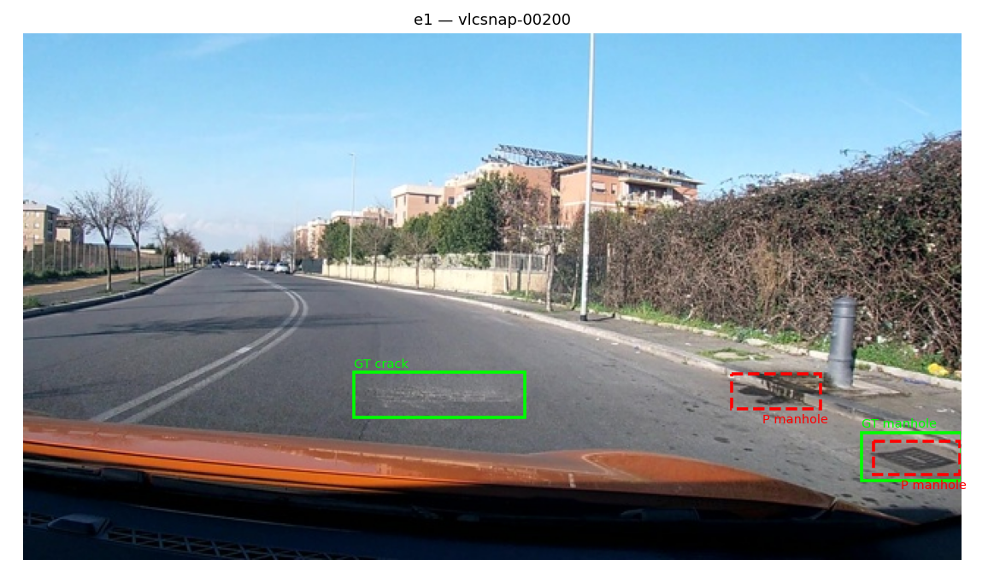
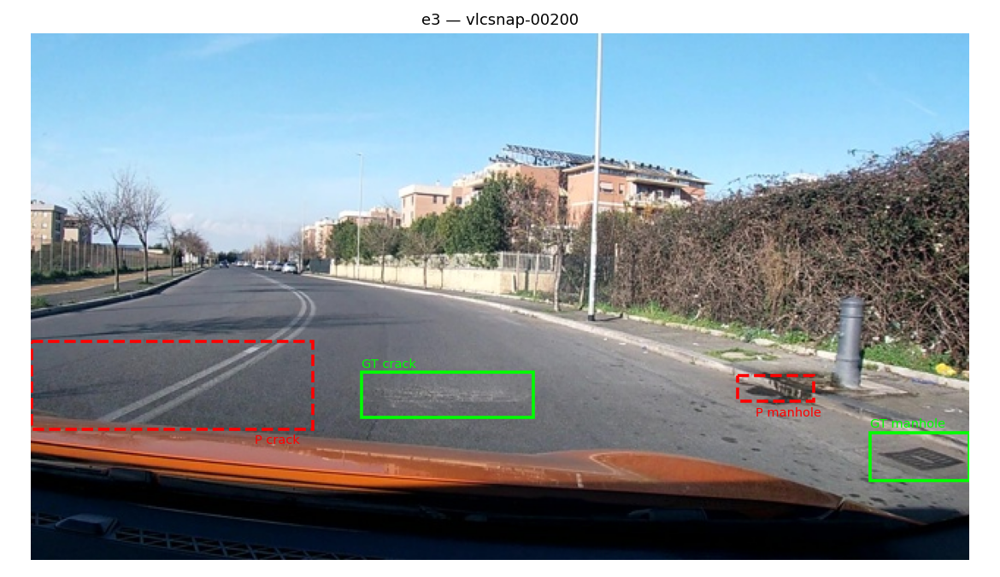

# Báo cáo Lab Day 10 — Qwen3-VL-4B

**Họ tên:** Lê Anh Duy

**MSSV:** 2A202602723

**Dataset version:** `d10-21e4070301`

Bài nộp dùng notebook, evidence và ảnh từ `K4-Track-4-Day10-VisionLanguageModel-main.zip`. Số liệu dưới đây lấy trực tiếp từ [report/evidence](report/evidence), không phải từ phiên bản Colab được chỉnh sửa trước đó trong repo.

E0 được chấm trên toàn bộ 311 ảnh test. E1–E3 và E4-pixel có **178 bước**, xấp xỉ một epoch với batch 2, tích lũy 4; chưa đạt mốc 300 bước của cấu hình mẫu. E4 thực tế dùng baseline **E2**, dù E1 có F1 cao nhất. Không có kết quả E5. ZIP không chứa prediction thô, checkpoint, log runtime hoặc output cell; báo cáo phân biệt số trong evidence với diễn giải và giả thuyết.

## Bảng tổng hợp

VRAM theo đơn vị của notebook (`bytes / 1e9`, GB); thời gian lấy từ `train_minutes`. Dấu “—” nghĩa là không được lưu, không phải bằng 0.

| Mã | Setup | Tham số train | VRAM (GB) | Phút | F1 | CI95 F1 | FP/ảnh | F1 pothole | F1 crack | F1 manhole |
|---|---|---:|---:|---:|---:|---|---:|---:|---:|---:|
| E0 | Zero-shot | 0 | — | — | 0.0559 | 0.0360–0.0789 | 1.257 | 0.1558 | 0.0070 | 0.1014 |
| E1 | LoRA LLM | 33,030,144 | 6.180 | 26.84 | **0.2554** | 0.2178–0.2965 | 1.267 | 0.2364 | 0.1616 | 0.5246 |
| E2 | E1 + projector | 87,609,344 | 7.503 | 26.69 | 0.0920 | 0.0668–0.1191 | 1.595 | 0.1733 | 0.0549 | 0.1667 |
| E3 | E2 + LoRA ViT | 93,900,800 | 6.652 | 32.61 | 0.0753 | 0.0553–0.0987 | 2.318 | 0.1129 | 0.0320 | 0.1974 |
| E4-norm1000 | Dùng lại E2 | 87,609,344 | 7.503 | 26.69 | 0.0920 | 0.0668–0.1191 | 1.595 | 0.1733 | 0.0549 | 0.1667 |
| E4-pixel | E2, đổi nhãn/prompt/thang chấm | 87,609,344 | 9.624 | 26.34 | 0.0073 | 0.0015–0.0146 | 2.489 | 0.0000 | 0.0100 | 0.0000 |

E4-norm1000 tái sử dụng cùng lần train E2, không phải một lần chạy độc lập; không cộng thêm thời gian đó vào tổng.

## 10 câu hỏi

### Câu 1 — Kiến trúc và khối được cập nhật

ViT trích xuất đặc trưng ảnh; projector/merger ánh xạ sang không gian LLM; LLM sinh JSON. DeepStack đưa thêm đặc trưng vision từ các tầng trung gian vào mô hình ngôn ngữ. GUIDE nêu quy mô tham khảo khoảng 4.44B toàn mô hình, 4.0B cho LLM và embedding, 415M cho nhánh vision. Projector nằm trong vision, không cộng hai lần.

Theo mã nguồn, E1/E2 dùng 252 module attention/MLP của LLM; E3 thêm 96 module ViT. Evidence lưu:

- **E1:** 33,030,144 tham số LoRA LLM; ViT/projector đóng băng.
- **E2:** 87,609,344; mở thêm `visual.merger` và `visual.deepstack_merger_list` để train đầy đủ. Phần tăng so với E1: **54,579,200**.
- **E3:** 93,900,800; thêm LoRA ViT, tăng **6,291,456** so với E2.

Phần tăng của E2 khác gợi ý khoảng 109M trong GUIDE. Giữ số đã lưu thay vì sửa evidence cho khớp gợi ý. ZIP không có checkpoint/cây model hoặc output đếm tham số để xác minh độc lập nguyên nhân.

### Câu 2 — E0: JSON hợp lệ và lỗi đầu ra

`parse_valid_rate=0.7331189711`, tương ứng **228/311** output hợp lệ, **83/311** không hợp lệ; `missing_predictions=0`. Số 245/311 và 66 lỗi trong báo cáo nguồn không khớp evidence nên không sử dụng.

Hai vấn đề có bằng chứng là tỷ lệ không parse được cao (26.69%) và nhiều box không khớp GT: precision **0.0668**, **391 FP**, **28 TP**. Riêng crack có 271 FP và 2 TP. Cắt cụt JSON ở giới hạn 256 token là một khả năng từ cấu hình; chưa thể xác định tỷ lệ cắt cụt, trùng box, sai vị trí hay sai lớp chỉ từ số tổng hợp.

ZIP không có prediction thô và notebook không lưu output cell, nên không thể trích ví dụ output thật. Không dùng chuỗi JSON minh họa trong báo cáo nguồn như một bằng chứng đã kiểm chứng.

### Câu 3 — Thang 0–1000 và pixel

Với ảnh 640×360: `x_px=x_norm*640/1000`, `y_px=y_norm*360/1000`. Hiểu nhầm thang làm box lệch vị trí/kích thước, giảm IoU và F1.

E2/E4-norm1000 đạt F1 **0.091954**, E4-pixel đạt **0.007342**. Đây là **hai mô hình train với hai quy ước nhãn/prompt và được chấm đúng thang tương ứng**, không phải cùng prediction bị cố ý chấm sai thang. Vì vậy không dùng chênh lệch này làm số đo trực tiếp của lỗi chấm sai thang.

Notebook có kiểm tra quy đổi box. Về mặt làm tròn, sai số tối đa khi quy ngược số nguyên 0–1000 về pixel so với box liên tục là 0.32 px theo x, 0.18 px theo y đối với box không bị clip. Không có output của kiểm tra để báo sai số thực nghiệm cụ thể. Dải pixel 0–640/0–360 nhỏ hơn 0–1000; kết quả kém không chứng minh nguyên nhân là “dải pixel lớn hơn”.

### Câu 4 — Mask loss

`encode_example()` encode prompt và hội thoại đầy đủ bằng cùng processor, kiểm tra prompt là tiền tố, rồi gán `labels[:, :n_prompt] = -100`. Loss chỉ áp dụng lên JSON và phần kết thúc hội thoại. Collator pad label bằng `-100`; patch ảnh và grid được nối theo chiều 0.

Mask giữ mục tiêu học là sinh đáp án từ ảnh/prompt. Tính loss cả prompt và token ảnh đưa thêm nhiều vị trí không phải đáp án vào mục tiêu, làm lệch trọng số học giữa prompt và JSON. Đây là loss dự đoán token, không phải loss tái tạo trực tiếp giá trị pixel. Code kiểm tra prefix/mask có trong notebook, nhưng ZIP không lưu output xác nhận lần chạy.

### Câu 5 — Lượng tử hóa và dtype projector

Notebook dùng NF4 4-bit và `llm_int8_skip_modules=['visual', 'lm_head']` để giữ nhánh vision, gồm projector, ở trọng số thông thường. Nếu projector cũng thành trọng số 4-bit thì không thể train đầy đủ nó như một bộ tham số dense bằng AdamW theo cách E2/E3 yêu cầu.

E2/E3 mở gradient và đưa tham số projector về fp32; forward dùng autocast fp16. Điều này hỗ trợ gradient/cập nhật ổn định hơn và phù hợp cách dùng AMP của notebook, không phải yêu cầu toán học duy nhất để train projector.

Phiên bản nguồn xử lý gradient fp16 bằng cách khôi phục tham số về fp32, xử lý `grad_dtype` nếu có, ép gradient về fp32 và tự chia scale trước optimizer. Đây là mô tả code; ZIP không có log môi trường/traceback để xác nhận độc lập lỗi dtype cụ thể của lần đo.

### Câu 6 — Split theo phiên quay

Frame gần nhau trong video thường rất giống nhau. Chia ngẫu nhiên có thể đưa ảnh gần trùng vào train/test, làm F1 phản ánh khả năng nhớ bối cảnh. Chia theo session giữ cả phiên trong cùng một split để hạn chế rò rỉ.

| Split | Ảnh | Pothole | Crack | Manhole |
|---|---:|---:|---:|---:|
| Train | 1,422 | 1,074 | 1,750 | 691 |
| Val | 276 | 66 | 470 | 103 |
| Test | 311 | 121 | 299 | 163 |

Bảng split lấy từ mô tả dataset của đề. Tổng GT test đối chiếu được bằng TP+FN: 121 pothole, 299 crack, 163 manhole, tổng 583 box. Mọi evidence cùng `dataset_version=d10-21e4070301`. ZIP không có split/meta gốc để kiểm tra lại session thực tế.

### Câu 7 — So sánh E1/E2/E3

Trong các lần chạy hiện có, **E1 tốt nhất**: F1 0.2554, hơn E2 khoảng 0.1634 và E3 khoảng 0.1801. Loss đầu/cuối trong metadata: E1 **1.0864 → 0.5836**, E2 **1.0362 → 0.6876**, E3 **1.0820 → 0.6836**. Loss giảm không bảo đảm F1 tăng tương ứng.

E2 dùng 7.503 GB/26.69 phút, E1 dùng 6.180 GB/26.84 phút. E3 lâu nhất, 32.61 phút, nhưng VRAM ghi nhận 6.652 GB thấp hơn E2; giữ nguyên số đo, không ép VRAM phải tăng theo tham số train. Tỷ lệ parse hợp lệ cũng khác: E1 98.07%, E2 85.21%, E3 92.28%.

Với ngân sách 178 bước này, mở projector/ViT chưa mang lại lợi ích F1. Chưa hội tụ, learning rate hoặc vấn đề dtype là giả thuyết cần kiểm chứng. Các setup có cùng ngân sách bước nên vẫn so sánh được trong ngân sách này; không đại diện cho kết quả tốt nhất sau khi tune đầy đủ.

### Câu 8 — Khoảng tin cậy và giới hạn kết luận

CI95 E1 [0.2178, 0.2965] rộng **0.0787**; E2 rộng **0.0523**, E3 rộng **0.0433**. E1 tách khá xa E2/E3 trong interval được cung cấp; E2/E3 chồng lấn nhiều.

Không có ngưỡng chung “chênh F1 dưới 0.03 luôn không đáng tin” hoặc quy tắc bắt buộc hai CI không chồng lấn. Nên tính CI trực tiếp của chênh lệch bằng paired bootstrap. `score.py` bootstrap theo ảnh, trong khi ảnh cùng session có thể tương quan; bootstrap theo session sẽ phù hợp cấu trúc dữ liệu hơn. CI hiện tại cũng không đo biến thiên theo seed train. Thiếu prediction/split gốc nên chưa tính lại các khoảng này.

### Câu 9 — Phân tích theo lớp và ảnh minh họa

**Crack có F1 thấp nhất ở E0–E3:** 0.0070, 0.1616, 0.0549, 0.0320. E1 có crack: 53 TP, 304 FP, 246 FN; manhole: 64 TP, 17 FP, 99 FN, F1 0.5246. Vết nứt mảnh, ranh giới không rõ và box nhạy với lệch vị trí là các giải thích hợp lý; chưa có phân tích kích thước/lỗi đủ để chứng minh nguyên nhân trên toàn tập.

Trong ảnh E1 trên, crack GT giữa mặt đường không có dự đoán crack tương ứng; nắp cống bên phải có box prediction gần GT, đồng thời có thêm prediction manhole gần lề. Đây là ví dụ trực quan về bỏ sót/dự đoán thừa, không thay thế tính IoU từ dữ liệu thô.

Ảnh khác giữ trong [report/figures](report/figures). Không dùng ảnh E4-pixel để kết luận vị trí box: hàm vẽ nguồn luôn chia prediction cho 1000, kể cả output pixel, nên hình nhánh đó có thể sai thang. Lỗi minh họa này không thay đổi evidence đã chấm bằng `--coord pixel`.

### Câu 10 — E4: ablation tọa độ

E4 đổi quy ước tọa độ trên **setup E2**, giữ rank 16, alpha 32, fraction 1.0 và 178 bước. Nhánh norm1000 dùng lại E2; nhánh pixel train lại với nhãn/prompt pixel, chấm bằng `--coord pixel`.

F1 giảm **0.091954 → 0.007342**, chênh **0.084612**. Nhánh pixel có 5 TP, 774 FP, 578 FN, parse hợp lệ 83.28%, FP/ảnh 2.489 và CI95 [0.0015, 0.0146]. Không có TP pothole/manhole.

Kết quả cho thấy pixel kém hơn norm1000 trong lần chạy E2 này, chưa đủ khái quát cho mọi setup/seed hoặc quy lỗi cho bộ chấm đọc sai thang. E4 chưa dùng setup tốt nhất E1, nên chưa đáp ứng trọn vẹn yêu cầu baseline. Notebook nộp ghim `E4_BASE_SETUP='E2'` để tái hiện đúng evidence, tránh tự chuyển sang E1 khi kết quả đã tồn tại.

## Nhìn lại và giới hạn

- Tổng hợp theo bộ kết quả được cung cấp, không chạy lại model hoặc tạo số đo mới.
- Giữ nguyên 178 bước và baseline E2; không sửa metadata để khớp mốc 300 bước/baseline tốt nhất.
- Evidence gốc giữ nguyên. Không có prediction, checkpoint, log môi trường hoặc output cell; đã kiểm tra tính nhất quán số tổng hợp, chưa chấm lại độc lập từ prediction.
- E5 chỉ có code/reward test tham khảo; không tuyên bố có kết quả GRPO hoặc điểm thưởng.
- Công cụ giảng viên trong `scripts/`, `tests/` và cấu hình mẫu giữ nguyên. `check_submission.py` kiểm tra cấu trúc bài nộp, không chứng minh đủ số bước, baseline E4 đúng hoặc tái lập GPU thành công.
